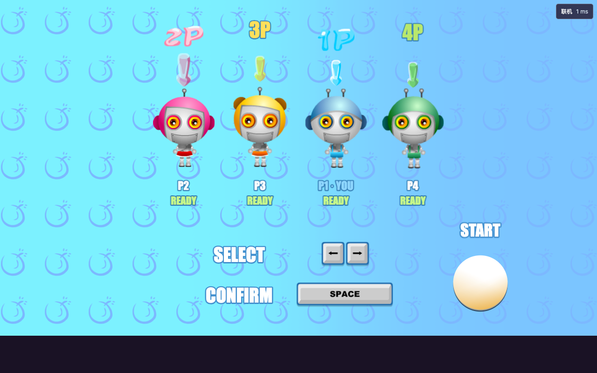
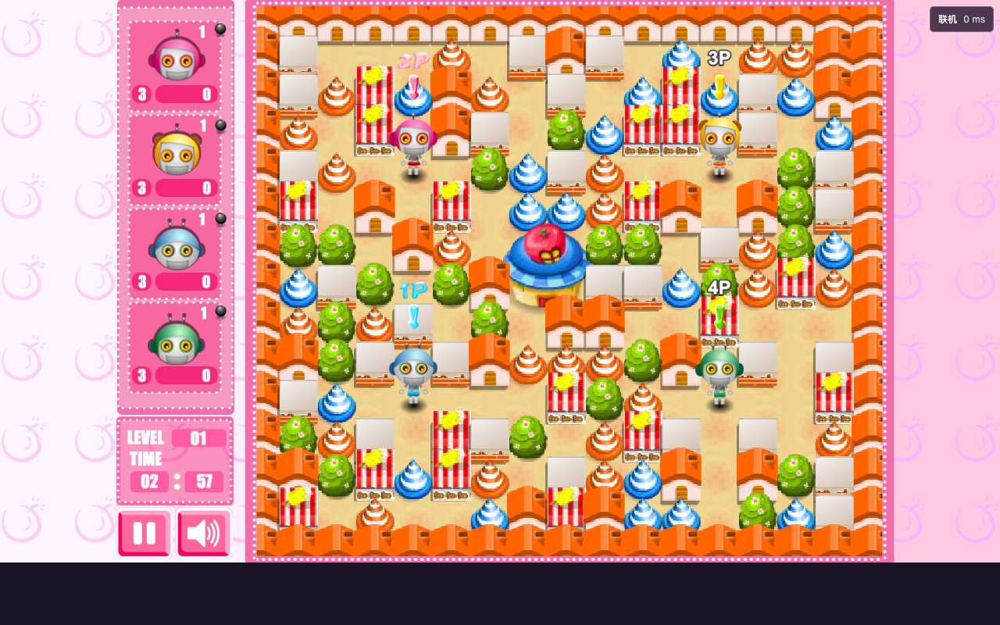

# Bomb It Online

**[Play online](https://bombit-online.pages.dev)**

Play original **Bomb It 1** single-player, or choose **Multiplayer** for **1–4 players online** with original scoring and unlimited rounds. CPUs fill empty slots. Friends join as **P1–P4**; no account or name needed.

The original menus, graphics, and sound are preserved. Room controls appear only after choosing Multiplayer. Share the invitation link to play together at **60 Hz**.





Run locally with Node.js 22+:

```sh
npm ci
npm start
```

Open [localhost:3000](http://localhost:3000). Move with arrow keys; press Space for bombs or weapons.

[Architecture](ARCHITECTURE.md) · [Original game and asset attribution](THIRD_PARTY.md)
